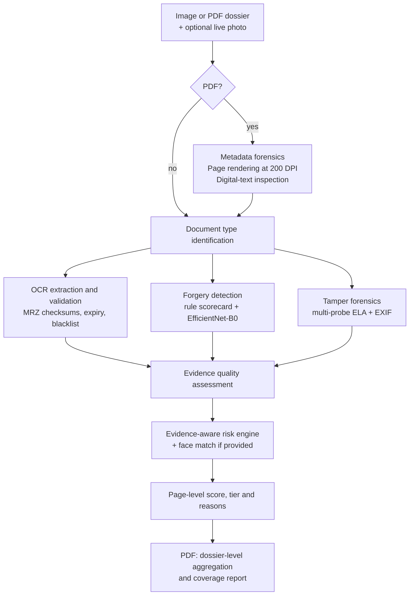

# ARGUS: Authentication & Recognition Guardian for Unified Screening

[](https://sih.gov.in)
[](https://sih.gov.in)
[](https://sih.gov.in)
[](https://sih.gov.in)
[](https://github.com/Aravkataria/ARGUS)
[](tests/)
[](LICENSE)

> **Smart India Hackathon 2026 | Problem Statement SIH26261**
> *AI-Powered Application Validation, Document Authentication and Regulatory Compliance Verification*
> **Organization:** AICTE | **Theme:** Smart Automation | **Category:** Software
> **Team:** NAVDRISHTI | **Team ID:** 198616

**ARGUS is an explainable, human-in-the-loop document screening engine.** It reads a single document image or a multi-page PDF dossier, runs visual forgery detection, tamper forensics and OCR validation on every page, and returns a risk tier together with the exact reasons behind it. It supports scrutiny officers by pointing them to the pages that deserve a closer look. It never approves or rejects anything on its own.

---

## At a Glance

| | |
| :--- | :--- |
| **Input** | A document image (PNG, JPG, ...) or a multi-page PDF dossier, plus an optional live photo |
| **Output** | Risk score (0-100), risk tier, decision, evidence-linked reasons, tamper heatmap, per-page findings for PDFs |
| **Interfaces** | Command-line tool (`screen.py`) and FastAPI service (`/screen`, `/screen/pdf`) |
| **Detection signals** | EfficientNet-B0 forgery model, multi-probe Error Level Analysis, EXIF and PDF metadata forensics, MRZ checksums, rule-based scorecard |
| **Dossier coverage** | Configurable screening window (`max_pages`), with explicit coverage reporting |
| **Runs** | Locally on CPU (GPU used automatically for OCR when CUDA is available), no external API calls |
| **Quality** | 67 automated tests across 7 files, evaluation notebook and logs included |

---

## Table of Contents

1. [Problem and Vision](#1-problem-and-vision)
2. [Project Status](#2-project-status)
3. [Alignment with PS SIH26261](#3-alignment-with-ps-sih26261)
4. [Demo](#4-demo)
5. [Quick Start](#5-quick-start)
6. [Screening Window and Coverage](#6-screening-window-and-coverage)
7. [How It Works](#7-how-it-works)
8. [Model Evaluation](#8-model-evaluation)
9. [API Reference](#9-api-reference)
10. [Planned AICTE Design](#10-planned-aicte-design)
11. [Safeguards and Responsible Use](#11-safeguards-and-responsible-use)
12. [Known Limitations](#12-known-limitations)
13. [Repository Structure](#13-repository-structure)
14. [Roadmap](#14-roadmap)
15. [References](#15-references)
16. [License and Disclaimer](#16-license-and-disclaimer)

---

## 1. Problem and Vision

The All India Council for Technical Education (AICTE) processes Extension of Approval applications supported by dossiers that can run to hundreds of pages: fire safety certificates, land deeds, affidavits, faculty records and intake declarations. Manual scrutiny at this scale is slow, and it can miss digitally altered documents, expired certificates, inconsistencies between declared intake and building capacity, and the same faculty member being declared at several institutions.

ARGUS performs the **first-pass screening automatically**, so that scrutiny officers can spend their time on the cases that need expert judgment. Every finding is linked to evidence and explained, and the final decision always stays with the competent authority.

**What this repository contains:** the working forensic and risk-scoring core of ARGUS, including PDF dossier ingestion, a trained visual forgery model, a CLI and an API. The AICTE-specific rule engine, signature verification, cross-document checks and officer dashboard are described in [Planned AICTE Design](#10-planned-aicte-design) and are not part of the current code.

---

## 2. Project Status

| Component | Status | Notes |
| :--- | :--- | :--- |
| FastAPI screening service (`/screen`, `/screen/pdf`, `/health`) | Implemented | Image or PDF, optional live photo, optional `max_pages` |
| Command-line tool (`screen.py`) | Implemented | Image or PDF, optional page-limit argument |
| PDF dossier ingestion | Implemented | Page rendering, digital-text inspection, metadata forensics, page-by-page screening, aggregation |
| Configurable screening window and coverage reporting | Implemented | `max_pages`, `partial_coverage` flag, manual review enforced on partial coverage |
| Document type identification | Implemented | Passport, visa, driving licence, national ID, or unknown |
| OCR extraction and validation | Implemented | EasyOCR (GPU used automatically when CUDA is available), MRZ parsing with checksums, expiry check, optional local blacklist |
| Rule-based forgery scorecard | Implemented | Interpretable score with stated reasons |
| EfficientNet-B0 visual forgery model | Implemented | Trained checkpoint included and wired into the pipeline |
| Tamper forensics (multi-probe ELA and EXIF) | Implemented | Tamper score plus heatmap |
| PDF metadata forensics | Implemented | Flags known editing software and modification after creation |
| Evidence quality assessment | Implemented | Reports how reliable the available evidence is |
| Evidence-aware risk engine | Implemented | Risk tier, decision and reasons |
| Face verification | Implemented (basic) | Haar cascade plus histogram similarity; designed to be swapped for an embedding model |
| Automated tests | Implemented | 67 tests in 7 files |
| Training and evaluation notebook | Included | `notebooks/argus_training_and_evaluation.ipynb` |
| AICTE APH rule engine (faculty ratio, cadre ratio, area norms) | Planned | Design only |
| PDF digital signature and QR verification | Planned | Design only |
| Cross-document and cross-institution checks | Planned | Design only |
| Officer dashboard and deficiency matrix | Planned | Design only |
| Issuing-authority connectors (DigiLocker, NAD, State e-District) | Planned | Subject to API access and permissions |

The visual forgery model and the tamper-forensics modules work on any document image. The OCR, document-type and validation modules currently target identity documents, and extending the rule-based checks to AICTE documents such as fire NOCs and land deeds is the next milestone.

---

## 3. Alignment with PS SIH26261

How the current prototype maps to the objectives of the problem statement:

| PS objective | ARGUS today | Next step |
| :--- | :--- | :--- |
| Detect potential document alterations, duplication and anomalies | Implemented: visual model, multi-probe ELA, EXIF and PDF metadata forensics, page-level evidence | Duplicate-page detection, forensics on embedded images |
| Identify missing, incomplete, expired or inconsistent information | Partial: OCR, expiry and consistency checks for identity documents | AICTE document types and configurable checklists |
| Explainable, evidence-linked results with human decision-making | Implemented: every flag carries its reasons, decisions are advisory, manual review is enforced on partial coverage | Evidence overlays in the dashboard |
| Handle large application dossiers | Implemented: multi-page PDF screening with a configurable window and coverage reporting | Parallel page processing, benchmarking |
| Verify through issuing authorities (APIs, QR, digital signatures) | Planned | pyHanko signature validation, QR decoding, connectors |
| Compliance and infrastructure assistance | Planned | Deterministic APH rule engine, evidence review |
| Dashboard, alerts and audit trail | Partial: structured JSON reports and a CLI report | Officer dashboard, audit log |

---

## 4. Demo


[Watch or download the full recording (`demo.mp4`)](demo.mp4)

---

## 5. Quick Start

Developed and tested on Windows with Python 3.14.

```bash
# 1. Clone the repository
git clone https://github.com/Aravkataria/ARGUS.git
cd ARGUS

# 2. Install dependencies
pip install -r requirements.txt

# 3. Run the test suite
python -m pytest -v
```

The first OCR request is slower because EasyOCR downloads its models on first use.

### Command-line screening

```bash
# Screen a single document image
python screen.py "C:\path\to\certificate.png"

# Screen a PDF dossier (default screening window: first 10 pages)
python screen.py "C:\path\to\dossier.pdf"

# Screen the first 20 pages of a PDF dossier
python screen.py "C:\path\to\dossier.pdf" 20

# Screen every page of a PDF dossier
python screen.py "C:\path\to\dossier.pdf" 0
```

The second argument is the page limit for PDFs. For a PDF the report shows total pages, pages processed, coverage status, metadata findings, the decision, the dossier risk tier and score, and the findings with their page numbers.

### API server

```bash
uvicorn app.main:app --host 0.0.0.0 --port 8000 --reload
```

Open `http://localhost:8000/docs` for the interactive Swagger UI.

### Optional blacklist

Document-number blacklist checks read a local file at `app/data/blacklist.json`. Create it if you want to test this feature:

```json
{
  "blacklisted_document_numbers": ["P1234567"]
}
```

---

## 6. Screening Window and Coverage

Dossiers can be very long, and a first-pass screen has to be fast. ARGUS therefore screens a **configurable window of pages** and tells the officer exactly how much of the dossier was covered.

| Setting | Behaviour |
| :--- | :--- |
| Default | The first 10 pages are screened for quick triage |
| CLI | `python screen.py dossier.pdf 20` screens up to 20 pages; `0` screens every page |
| API | Send `max_pages` as a form field; set it to the page count to screen the whole dossier |
| Library | `screen_pdf_dossier(path, max_pages=N)`; `None` or `0` screens every page |

Every PDF result reports `total_pages`, `pages_processed` and `partial_coverage`. When the window is smaller than the dossier, ARGUS adds a coverage note to the findings and sets the decision to **MANUAL_REVIEW**, so a partially screened dossier is never presented as cleared. When the whole dossier is screened, the decision follows the risk tier as usual.

---

## 7. How It Works



**Visual forgery model.** A fine-tuned EfficientNet-B0 takes a 224 x 224 input and outputs a forged probability.

| Forged probability | Outcome |
| :--- | :--- |
| below 0.30 | Likely authentic |
| 0.30 to below 0.69 | Manual review |
| 0.69 or above | Forged risk |

The 0.69 threshold was chosen on the validation split by maximizing F1. The checkpoint is `app/models/argus_efficientnet_b0_corrected_best.pth`.

**Tamper forensics.** Error Level Analysis (ELA) is probed at JPEG qualities 50, 70 and 90 and normalized block by block to reduce false alarms on genuine scans. EXIF inspection looks for editing-software tags and missing camera or scanner metadata. The module returns a tamper score and a heatmap image.

**PDF dossier screening.** For a PDF, ARGUS:
1. Reads the document metadata (creator, producer, creation and modification dates) and flags known image-editing or design software.
2. Renders each page in the screening window to an image (200 DPI by default) and extracts the native digital text of the page.
3. Runs every rendered page through the same pipeline used for images.
4. Combines the results: the dossier risk score is the highest page score, the dossier tier is the highest page tier, and all findings are listed with their page numbers.
5. Reports coverage and enforces manual review when the window is smaller than the dossier (see [Screening Window and Coverage](#6-screening-window-and-coverage)).

**Evidence-aware decisions.** The risk engine does not trust a single signal. For example, a low model probability combined with a significant OCR anomaly is sent to manual review rather than marked authentic.

**Engineering notes.** The OCR reader and the forgery model are loaded once and reused across pages. EasyOCR switches to the GPU automatically when CUDA is available. Temporary page images are cleaned up after every request.

---

## 8. Model Evaluation

**Data.** The model was trained and evaluated on a 2,992-image dataset:

| Source | Authentic | Forged |
| :--- | ---: | ---: |
| CASIA v2.0 | 993 | 1,000 |
| CEDAR | 499 | 0 |
| RVL-CDIP | 500 | 0 |

Training, validation and test splits are independent (the notebook checks for overlap). Results are on the **held-out test split of 449 images (299 authentic, 150 forged)**.

| Metric | Value |
| :--- | ---: |
| ROC-AUC | 0.9020 |
| Accuracy (threshold 0.69) | 85.30% |
| Precision | 78.77% |
| Recall | 76.67% |
| F1 score | 77.70% |
| Accuracy on CASIA v2.0 subset | 76.92% |

**Reading the numbers.**
- All forged samples come from CASIA v2.0, which contains tampered natural images. CEDAR and RVL-CDIP contribute authentic samples only, so the **CASIA v2.0 subset accuracy (76.92%) is the most direct measure of forgery-detection performance**.
- These results measure the visual classifier on image files. Evaluation on pages rendered from PDFs and on AICTE-style documents such as fire NOCs, land deeds and affidavits is the next evaluation milestone.

**Reproducibility.**
- Training and evaluation notebook: [`notebooks/argus_training_and_evaluation.ipynb`](notebooks/argus_training_and_evaluation.ipynb)
- Audit logs (20 CSV files): [`model/results/ARGUS_DATASET/`](model/results/ARGUS_DATASET/)
- ROC curve, confusion matrix and Grad-CAM figures: [`model/results/figures/`](model/results/figures/)

The notebook covers threshold analysis, Grad-CAM attention analysis, forensic feature analysis, OCR consistency, evidence fusion, robustness checks and a cross-dataset audit.

---

## 9. API Reference

### `GET /health`

Returns a simple status response.

### `POST /screen`

Multipart form with:

| Field | Required | Description |
| :--- | :--- | :--- |
| `document` | Yes | An image (any `image/*` type) or a PDF |
| `live_photo` | No | Selfie or live image, used for face verification |
| `max_pages` | No | Number of PDF pages to screen (default: 10). Set it to the page count to screen the whole dossier. Ignored for images |

```bash
# Image
curl -X POST http://localhost:8000/screen \
  -F "document=@document.jpg" \
  -F "live_photo=@selfie.jpg"

# PDF dossier, first 20 pages
curl -X POST http://localhost:8000/screen \
  -F "document=@dossier.pdf" \
  -F "max_pages=20"
```

For an image, the response contains one section per module: `ocr`, `document_type`, `validation`, `forgery_prediction` (with `rules` and `visual_model`), `evidence_quality`, `tampering` (including a base64 heatmap), `face_verification`, and `risk` (score, tier, decision and reasons).

### `POST /screen/pdf`

A dedicated endpoint for PDF dossiers, with the same form fields as `/screen`. Uploading a PDF to `/screen` produces the same result.

```bash
curl -X POST http://localhost:8000/screen/pdf \
  -F "document=@dossier.pdf" \
  -F "max_pages=50"
```

The PDF response contains:

| Field | Description |
| :--- | :--- |
| `document_format` | `PDF` |
| `total_pages` / `pages_processed` | Pages in the file and pages actually screened |
| `partial_coverage` | `true` when `pages_processed` is lower than `total_pages`; manual review is then enforced |
| `dossier_risk_tier` / `dossier_risk_score` | Highest page tier and highest page score |
| `risk` | Score, tier, decision and the combined list of reasons |
| `metadata_audit` | Creator, producer, dates, and any editing-software flags |
| `findings_summary` | Findings from all screened pages, each labelled with its page number |
| `pages` | Per-page document type, risk tier and score, tamper and ELA scores, visual model output, digital-text information and findings |

---

## 10. Planned AICTE Design

> **Status: design only.** Nothing in this section is part of the current code. Performance figures are goals that will be benchmarked, not measurements.

ARGUS is designed around four pillars for AICTE dossier scrutiny:

1. **Pixel-level forensics.** Multi-quality ELA, block-wise analysis and the EfficientNet-B0 classifier flag altered dates, masked text and duplicated seals in documents such as fire NOCs and land deeds. Findings are indicators that need verification, not proof of forgery.
2. **Cryptographic trust bridge.** PAdES-compatible validation of PDF digital signatures with pyHanko, certificate chain checks against configured trust anchors, and QR decoding checked against trusted reference data. Verification results use distinct statuses: verified, mismatch, expired, verification pending, source unavailable and manual review required. Connected verification through DigiLocker, NAD and State e-District services is planned where access is authorized.
3. **Deterministic APH norms solver.** AI is used only to extract data. Compliance is calculated by deterministic rules from the AICTE Approval Process Handbook (faculty-student ratio, cadre ratio, area requirements), and each calculation records its inputs, outcome and the provision applied. Missing or ambiguous data is flagged for manual review, never assumed compliant.
4. **Cross-document and cross-entity triangulation.** An evidence graph links declarations to supporting documents, for example approved intake against fire-NOC capacity, and flags possible duplicate faculty deployment across institutions using privacy-controlled, keyed identifiers where legally permitted, always with human review.

**Planned technology stack:** TrOCR on selected regions, pyHanko and PyZbar for signatures and QR codes, Redis for job queuing, PostgreSQL for findings and audit events, and a React-based scrutiny officer dashboard with heatmap overlays and a deficiency matrix.

**Illustrative output.** The table shows the intended deficiency matrix on a synthetic dossier. It is a design mock-up, not output from the current code.

| Parameter | Norm | Computed from dossier | Flag |
| :--- | :--- | :--- | :--- |
| Faculty-student ratio | Max 1:20 (B.Tech) | 1:18.2 (52 faculty, 946 students) | Compliant |
| Cadre ratio (Prof : Assoc : Asst) | 1 : 2 : 6 | 0 : 15 : 37 | Deficient |
| Fire safety NOC validity | Valid on date of scrutiny | Expired 12-Dec-2025 | Anomaly |
| Approved intake vs fire NOC capacity | Capacity >= intake | Capacity 450, intake 600 | Safety risk |

**Performance goals (to be benchmarked).**

| Goal | Value |
| :--- | :--- |
| Processing time for a 200+ page dossier | Under 15 minutes |
| End-to-end time per page | Under 1.8 seconds on a 4-core CPU |
| Inference latency of the visual model | Under 140 ms per patch on a 4-core CPU |
| Memory footprint | Under 1.5 GB RAM |
| Throughput | To be reported after benchmarking |
| Deployment | CPU-only, self-hosted, able to run fully offline |

These goals will be benchmarked on specified four-core hardware with representative dossiers and reported under reproducible conditions.

---

## 11. Safeguards and Responsible Use

- **Advisory only.** ARGUS supports scrutiny officers. Statutory scrutiny, inspection and final regulatory decisions remain with the competent authority, and human review is required before any adverse action.
- **Explainable.** Every flag carries its evidence and reasons. The rule-based scorecard is interpretable by design.
- **Conservative aggregation.** A dossier is only as reassuring as its most suspicious page, and a partially screened dossier always goes to manual review.
- **Privacy.** Document processing stays on local infrastructure with no commercial API calls. Any identity matching in the planned design would be limited to authorized deployments, use keyed identifiers, require access controls and key management, and always be reviewed by a person.
- **Access control.** The system must not bypass access controls or assume access to restricted databases.

---

## 12. Known Limitations

- **Scope of the rule-based checks.** The OCR, document-type identification and validation modules target identity documents, so AICTE documents such as fire NOCs and land deeds are typically reported as an unrecognized document type. The visual model and tamper forensics work on any image.
- **Forgery-detection evidence.** Results come from CASIA v2.0 forged samples only. Performance on official-document forgeries and on pages rendered from PDFs is not yet measured.
- **ELA on digital PDFs.** Error Level Analysis relies on JPEG compression history. A page rendered from a digitally generated PDF has none, so ELA is most informative on scanned pages and embedded scan images.
- **PDF metadata checks are heuristics.** Documents processed with ordinary PDF utilities or design tools can legitimately carry their names in the metadata.
- **PDF digital signatures are not verified** in the current code.
- **Face verification** uses a lightweight histogram comparison that is sensitive to lighting and pose. It is designed to be replaced by an embedding model.
- **The blacklist** is a local JSON file standing in for a real government database.
- **Performance.** Processing speed and memory use have not been formally benchmarked, and pages are currently screened one after another. Parallel page processing is on the roadmap.
- **Planned AICTE components** listed in [Project Status](#2-project-status) are not implemented yet.

---

## 13. Repository Structure

```text
ARGUS/
├── app/
│   ├── main.py                          # FastAPI app (/screen, /screen/pdf, /health)
│   ├── models/
│   │   └── argus_efficientnet_b0_corrected_best.pth
│   └── modules/
│       ├── document_type_identification.py
│       ├── ocr_extraction.py
│       ├── document_validation.py
│       ├── forgery_model.py
│       ├── forgery_prediction.py
│       ├── tampering_detection.py
│       ├── pdf_processor.py             # PDF ingestion, coverage and dossier aggregation
│       ├── evidence_quality.py
│       ├── face_verification.py
│       └── risk_engine.py
├── model/
│   └── results/
│       ├── ARGUS_DATASET/               # 20 evaluation CSV logs
│       └── figures/                     # ROC curve, confusion matrix, Grad-CAM
├── notebooks/
│   └── argus_training_and_evaluation.ipynb
├── tests/                               # 67 tests in 7 files
├── screen.py                            # command-line screening tool (image or PDF)
├── demo.gif / demo.mp4                  # terminal demonstration
├── final.pdf / final.pptx               # SIH 2026 presentation
├── requirements.txt
└── LICENSE
```

---

## 14. Roadmap

1. Parallel page processing and a published benchmark on four-core CPU hardware.
2. Evaluate the visual model on AICTE-style documents, including pages rendered from PDFs, and add document-forgery data.
3. Build the deterministic APH rule engine with versioned, configurable checklists.
4. Add PAdES signature validation and QR verification for PDFs.
5. Run forensics on images embedded in PDFs, in addition to rendered pages.
6. Add duplicate-page detection, cross-document consistency checks and privacy-controlled duplicate-faculty detection.
7. Build the scrutiny officer dashboard with evidence overlays, a deficiency matrix and an audit trail.
8. Integrate issuing-authority connectors (DigiLocker, NAD, State e-District) where access is authorized.

---

## 15. References

- AICTE Approval Process Handbook 2024-27 (faculty-student ratio, cadre ratio and infrastructure norms)
- Information Technology Act, 2000, Sections 3 and 3A (authentication of electronic records)
- ETSI EN 319 142 (PAdES) and ISO 32000 (PDF)
- Krawetz, N. (2007). *A Picture's Worth: Digital Image Analysis and Forensics* (Error Level Analysis). Black Hat Briefings
- Tan, M. and Le, Q. V. (2019). *EfficientNet: Rethinking Model Scaling for Convolutional Neural Networks.* ICML. [arXiv:1905.11946](https://arxiv.org/abs/1905.11946)
- CASIA Image Tampering Detection Dataset v2.0; CEDAR signature dataset; RVL-CDIP document image dataset

---

## 16. License and Disclaimer

Released under the [MIT License](LICENSE).

ARGUS is an experimental screening and decision-support prototype built for Smart India Hackathon 2026. A score or flag from ARGUS is not proof that a document or identity is genuine or fraudulent. Real deployment would require validated datasets, security review, privacy protections, legal authorization and independent forensic validation.
